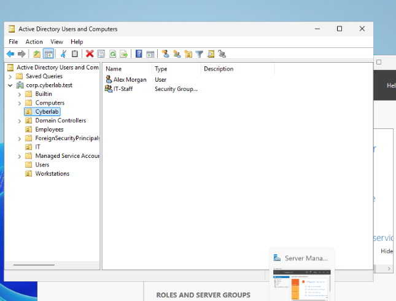

# Active Directory & pfSense Home Lab

A hands-on virtualized IT and cybersecurity lab built with **Oracle VirtualBox**, **Windows Server 2022**, **Windows 11**, **pfSense**, and **Kali Linux**. The goal was to practice core enterprise networking, centralized identity management, and troubleshooting in an isolated environment.

## Lab overview

| Component | Role | Lab configuration |
| --- | --- | --- |
| pfSense | Firewall, gateway, and routing between virtual networks | LAN gateway: `192.168.10.1` |
| Windows Server 2022 (`DC01`) | Active Directory Domain Services (AD DS) and DNS | `192.168.10.10` |
| Windows 11 (`Windows11-Works`) | Domain-joined workstation | `192.168.10.100` |
| Kali Linux | Linux testing environment | Included in the virtual lab |

**Active Directory domain:** `corp.cyberlab.test`  
**Internal subnet:** `192.168.10.0/24`  
**Workstation DNS server:** `192.168.10.10`

### Simplified network layout

```text
                 VirtualBox NAT / external connectivity
                               |
                          pfSense WAN
                          pfSense LAN
                         192.168.10.1
                               |
                      Internal lab network
                        192.168.10.0/24
                           /       \
                          /         \
              Windows Server 2022   Windows 11
                 DC01               Windows11-Works
              192.168.10.10         192.168.10.100
              AD DS + DNS           Domain workstation
```

## What I configured

1. **Virtual networking:** Configured pfSense with separate WAN and LAN interfaces to act as the lab's gateway.
2. **Domain services:** Installed and configured AD DS and DNS on Windows Server 2022, promoting `DC01` to a domain controller for `corp.cyberlab.test`.
3. **Directory structure:** Created organizational units (OUs), including `Cyberlab`, `Employees`, `IT`, and `Workstations`. Created an example user, **Alex Morgan**, and an **IT-Staff** security group in the `Cyberlab` OU.
4. **Workstation integration:** Connected the Windows 11 workstation to the domain and signed in using the domain account `CORP\amorgan`.
5. **Connectivity checks:** Verified domain identity, DNS name resolution, and connectivity to the pfSense LAN gateway.

## Validation and evidence

### 1. Domain sign-in

On the Windows 11 workstation, I used:

```powershell
whoami
hostname
$env:LOGONSERVER
```

Observed values:
- Domain account: `corp\amorgan`
- Hostname: `Windows11-Works`
- Logon server: `\\DC01`

These checks demonstrate the workstation's domain user context and the domain controller associated with the logon session.

### 2. DNS and network connectivity

```powershell
ipconfig /all
nslookup corp.cyberlab.test
ping 192.168.10.1
```

The workstation used `192.168.10.10` for DNS and `192.168.10.1` as its default gateway. The domain name resolved to `192.168.10.10`, and the gateway replied to four ping requests with 0% packet loss.

**Note:** A successful DNS lookup demonstrates name resolution, not by itself the full health of Active Directory or authentication services.

### 3. Active Directory objects

Used **Active Directory Users and Computers (ADUC)** to inspect the domain's OU structure and verify that the example user and security group existed.

## Screenshots and evidence

### 1. Domain authentication

The Windows 11 workstation was signed in as `corp\amorgan`. PowerShell checks confirmed the workstation name (`Windows11-Works`) and the logon server (`\\DC01`).


### 2. DNS resolution and gateway connectivity

The workstation resolved `corp.cyberlab.test` to `192.168.10.10` and successfully pinged the pfSense LAN gateway at `192.168.10.1`.


### 3. Active Directory users and groups

Active Directory Users and Computers shows the custom `Cyberlab` organizational unit, the **Alex Morgan** user account, and the **IT-Staff** security group.



## Skills practiced

- Windows Server and Active Directory administration
- Domain joining and centralized user authentication
- DNS, IP addressing, DHCP client configuration, and default gateways
- pfSense virtual firewall and network segmentation concepts
- PowerShell and Windows network troubleshooting
- Technical validation and documentation

## Lessons learned

This lab helped connect networking fundamentals with enterprise identity management. In particular, I practiced distinguishing **DNS resolution**, **network connectivity**, and **domain authentication** as separate things to validate when troubleshooting a Windows domain environment.

## Next steps

- Add annotated evidence screenshots to this repository.
- Practice additional domain troubleshooting scenarios.
- Explore Windows event logs and security monitoring in a follow-up project.

---

*This is a self-directed learning lab using example accounts and an isolated virtual environment, not a production deployment.*
